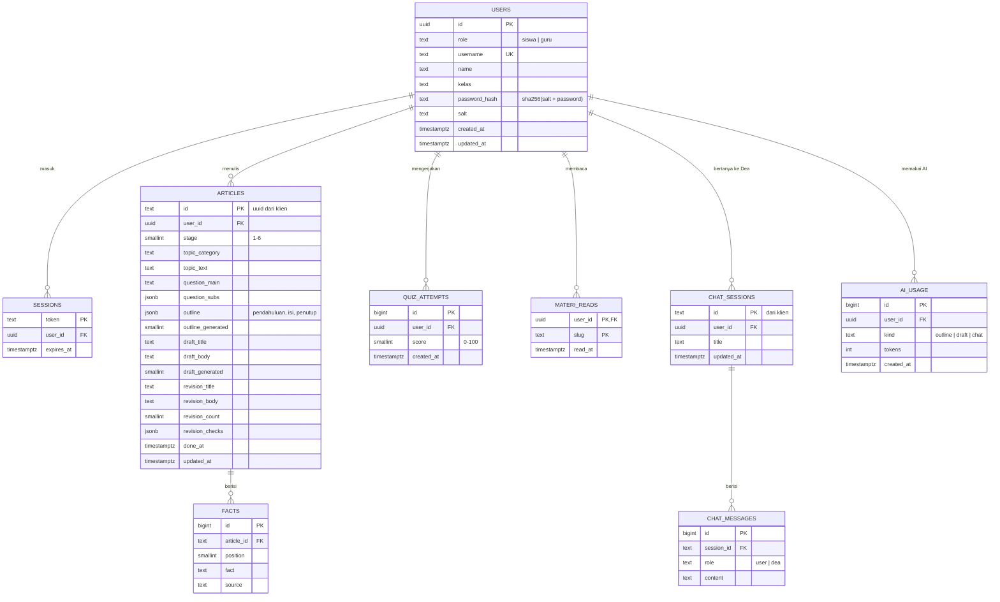

# ERD Ideaksi

Database: Supabase (Postgres). Skema lengkap ada di [`supabase/schema.sql`](../supabase/schema.sql), data awal di [`supabase/seed.sql`](../supabase/seed.sql).

## Catatan

- **Keamanan:** semua tabel memakai Row Level Security tanpa policy. Hanya backend (Google Apps Script dengan *service role key*) yang bisa membaca/menulis; kunci publik tidak bisa mengakses apa pun.
- **View `student_progress`:** ringkasan per siswa (artikel terakhir, tahap, skor kuis terbaik, jumlah bab materi) untuk dashboard guru.
- **Fungsi `save_article(user, json)`:** menyimpan artikel beserta faktanya dalam satu transaksi, dan menolak menimpa artikel milik siswa lain.
- **Memori Tanya Dea:** setiap pertanyaan hanya membawa 6 pesan terakhir dari obrolan yang sama, supaya hemat kuota.
- **Batas harian AI:** dihitung dari `ai_usage` (lihat `DAILY_LIMIT` di backend).
